<h1 align="center">Diego Moura dos Santos</h1>

<p align="center">
  <b>Estudante de programação</b> · Python · JavaScript · Next.js
  <br/>
  <sub>Marília, SP · Disponível para remoto</sub>
</p>

<p align="center">
  
</p>

Olá, me chamo **Diego** e sou um estudante de programação, cursando ADS no SENAI Pompéia. Pretendo fazer uma faculdade em Engenharia de Software e uma pós em Cybersegurança. Trabalho com **Python**, **JavaScript** e **Next.js**. Construo APIs com **autenticação JWT**, trabalho com bancos **SQL (MySQL)** e **NoSQL (MongoDB)** e testo meus projetos com **pytest** e **Postman**. Busco minha primeira oportunidade de trabalho, presencial, híbrida ou remota em Marília.

```bash
dieggo7@dev:~$ ls stack/
```

**back-end**
<br/>


**estilização**
<br/>


**dados · infra**
<br/>


**testes**
<br/>


**ferramentas**
<br/>


```bash
dieggo7@dev:~$ cat projetos.md
```

### 🚀 [Cellarium](https://github.com/dieggo7/cellarium-backend)

API de otimização do fluxo de requisições do almoxarifado (Til Marcon), com leitura de QR Code, baixa automática de estoque, histórico de movimentações, autenticação JWT e testes automatizados.

- **Autenticação JWT** com access e refresh tokens
- **77 testes** com pytest · endpoints validados no Postman
- **Banco de dados:** MySQL
- **Deploy:** [link do projeto em produção](https://cellarium-rouge.vercel.app/)

`Python` `JWT` `MySQL` `pytest` `Postman`


```bash
dieggo7@dev:~$ ./contato.sh
```

<p>
  <a href="https://www.linkedin.com/in/diego-moura-4214293ab/?isSelfProfile=true">
    
  </a>
  <a href="diegaomoura962@gmail.com">
    
  </a>
</p>